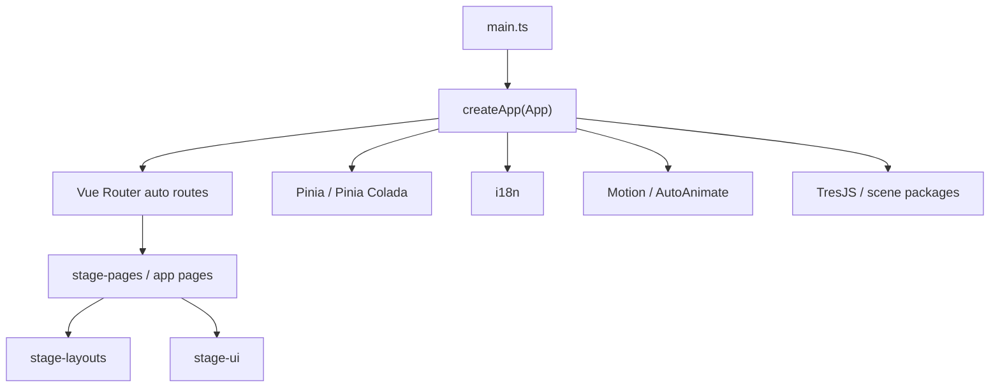
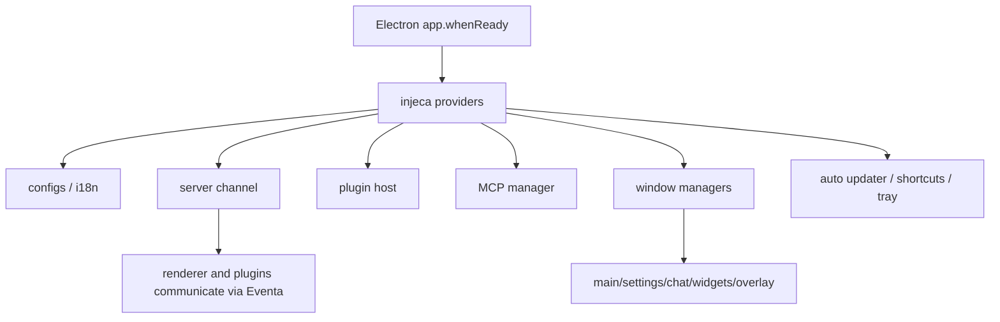
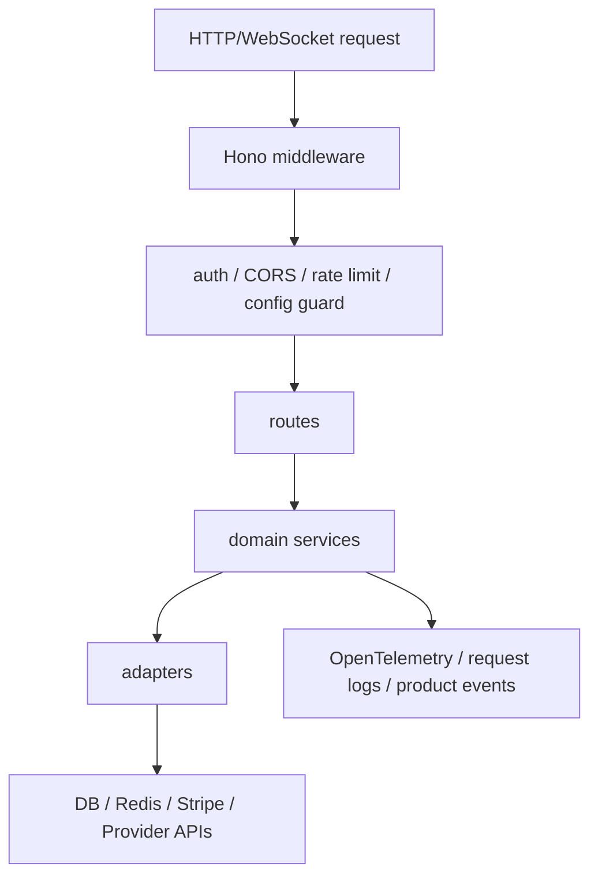
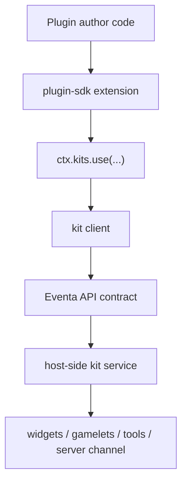

# Project AIRI 工程说明

本文档面向准备参与 Project AIRI 开发、调试、二次开发或做架构梳理的工程成员。内容基于当前仓库结构、workspace 配置和关键入口文件整理，重点说明工程结构、功能边界、技术栈、模块职责与主要实现路径。

## 1. 项目定位

Project AIRI 是一个面向 AI 虚拟角色 / 数字生命 / AI VTuber 的多端工程。它把大语言模型、语音识别、语音合成、角色状态、Live2D/Spine/VRM/Three.js 场景、插件系统、服务端账号与计费、聊天同步、外部平台连接等能力放在一个 pnpm monorepo 中维护。

从产品形态看，当前主线包括：

- Web 端：浏览器中运行 AIRI stage 体验。
- Desktop 端：基于 Electron 的 stage-tamagotchi，提供桌面窗口、悬浮窗、系统托盘、全局快捷键、本地插件和本机能力。
- Mobile 端：基于 Capacitor 的 stage-pocket，复用 Web/Vue 主体能力并接入 iOS/Android。
- Server 端：Hono + WebSocket 的账号、聊天、供应商、Flux、计费、TTS/ASR 代理与 OpenAI-compatible API。
- 插件与外部服务：Bilibili、Home Assistant、VS Code、Discord、Telegram、Minecraft、Satori、Twitter/MCP 等。

## 2. Monorepo 与构建体系

仓库使用 pnpm workspace 管理多包，根包为 `@proj-airi/root`。主要配置如下：

- 包管理：`pnpm@10.33.0`
- 任务编排：`turbo`
- 语言：TypeScript 为主，Vue SFC、少量 Kotlin/Swift/Godot C#
- 构建工具：Vite、electron-vite、tsdown、VitePress
- 测试：Vitest、Vitest Browser、Playwright
- 代码质量：`moeru-lint`、ESLint、Oxlint、Knip
- 样式：UnoCSS、`@unocss/reset`、Iconify 图标
- workspace 范围：`apps/**`、`packages/**`、`plugins/**`、`services/**`、`integrations/**`、`docs/**`、`engines/**`

常用根命令：

```sh
pnpm dev:web
pnpm dev:tamagotchi
pnpm dev:pocket:ios
pnpm dev:pocket:android
pnpm dev:server
pnpm build
pnpm build:web
pnpm build:tamagotchi
pnpm typecheck
pnpm lint
pnpm test:run
```

推荐在日常开发中使用 workspace filter 缩小范围，例如：

```sh
pnpm -F @proj-airi/stage-web dev
pnpm -F @proj-airi/stage-tamagotchi typecheck
pnpm -F @proj-airi/stage-ui test:run
pnpm exec vitest run path/to/file.test.ts
```

## 3. 总体目录结构

```text
.
├── apps/                         # 可运行应用
├── packages/                     # 可复用核心包、UI、SDK、运行时和工具
├── services/                     # 外部平台 Bot、MCP、Minecraft、Twitter 等服务
├── plugins/                      # AIRI 插件实现
├── integrations/                 # IDE/平台集成
├── engines/                      # 非 Web 引擎实验与运行时
├── docs/                         # 文档站、方案记录、工程上下文
├── scripts/                      # 仓库级脚本
├── patches/                      # pnpm patchedDependencies 补丁
├── bucket/                       # Scoop 发布相关资源
└── nix/                          # Nix 开发环境支持
```

仓库内部分工可以理解为：

- `apps/*` 负责最终用户或运维可启动的应用。
- `packages/stage-*` 负责多端共享的角色、场景、页面、布局和 UI 业务逻辑。
- `packages/server-*` 负责服务端运行时、客户端 SDK 和共享协议。
- `packages/plugin-*` 负责插件协议、插件 SDK 和桌面插件 DX。
- `services/*` 负责连接外部生态或实验性 Agent 服务。
- `plugins/*` 是基于 SDK 的具体插件。

## 4. 核心技术栈

### 前端 / Stage

- Vue 3 + Composition API + `<script setup>`
- Vue Router 自动路由：`unplugin-vue-router`
- Layout 自动注入：`vite-plugin-vue-layouts`
- Pinia 与 Pinia Colada
- VueUse 与 VueUse Motion
- UnoCSS + Iconify
- Reka UI 作为底层 headless primitive
- TresJS / Three.js / VRM 用于 3D 角色场景
- Pixi + pixi-live2d-display 用于 Live2D
- Spine WebGL 用于 Spine 2D
- Web Workers、AudioWorklet、WebGPU、WebAudio、WASM 等浏览器能力

### Desktop

- Electron 41
- electron-vite
- Electron main / preload / renderer 分层
- `injeca` 做 main 进程服务依赖注入与生命周期组合
- `@moeru/eventa` 做 Electron IPC/RPC 契约
- `@proj-airi/electron-screen-capture`、`uiohook-napi`、系统托盘、全局快捷键、自动更新

### Server

- Hono + `@hono/node-server`
- Hono WebSocket：`@hono/node-ws`
- Drizzle ORM
- PGlite / PostgreSQL
- Redis / ioredis
- Better Auth
- Stripe
- OpenTelemetry + Langfuse
- OpenAI-compatible routes、TTS/ASR streaming proxy

### AI / Agent / Audio

- xsAI 系列包：文本生成、流式生成、TTS、ASR、工具调用、embedding
- HuggingFace Transformers
- MediaPipe
- VAD、音频重采样、AudioWorklet
- `@proj-airi/core-agent` 与 `@proj-airi/core-character`
- Mineflayer、Discord.js、grammY、MCP SDK 等外部平台能力

## 5. 主应用实现

### 5.1 `apps/stage-web`

Web 版 AIRI stage。主要目录：

```text
apps/stage-web/src
├── main.ts               # Vue app 入口
├── App.vue
├── pages/                # 自动路由页面
├── components/           # Web 端专属组件
├── composables/          # Web 端组合式逻辑
├── modules/              # i18n、PWA 等模块
├── stores/               # Pinia stores
├── styles/               # 全局样式和转场
└── workers/              # VAD 等浏览器 worker
```

实现特点：

- `src/main.ts` 创建 Vue 应用，注册 Motion、AutoAnimate、Vue Router、Pinia、Pinia Colada、i18n、TresJS。
- 使用 `createWebHistory()`，在 HuggingFace Space 目标环境下切换为 hash history。
- 路由来自 `vue-router/auto-routes`，再经 `setupLayouts()` 绑定布局。
- 页面中复用 `packages/stage-pages`、`packages/stage-layouts`、`packages/stage-ui`、`packages/stage-ui-three/live2d/spine`。
- `workers/vad` 与 `composables/audio-*` 承担浏览器侧麦克风输入、VAD 和音频处理。

### 5.2 `apps/stage-tamagotchi`

Electron 桌面版，是当前桌面主线。目录分层：

```text
apps/stage-tamagotchi/src
├── main/                 # Electron main 进程
├── preload/              # preload bridge
├── renderer/             # Vue renderer
└── shared/               # main/renderer 共享契约与类型
```

main 进程关键实现：

- `src/main/index.ts` 是启动入口。
- 使用 `injeca` 注册配置、i18n、自动更新、服务端 channel、本地 HTTP server、Godot stage manager、MCP stdio manager、插件 host、窗口管理器等。
- 窗口模块位于 `src/main/windows/*`，包括 main、settings、chat、caption、desktop-overlay、widgets、spotlight、about、notice、onboarding、beat-sync、devtools。
- Electron service 位于 `src/main/services/electron/*`，包括 app、screen、window、system preferences、powerMonitor、auto-updater、global shortcut。
- AIRI domain service 位于 `src/main/services/airi/*`，包括 channel-server、plugins、widgets、MCP servers、Godot stage、auth、HTTP server。
- Linux 下启动时设置 WebGPU / Wayland 相关 Electron command line switch。
- `@proj-airi/electron-screen-capture/main` 提供屏幕捕获主进程初始化。

renderer 关键实现：

- `src/renderer/main.ts` 创建 Vue app，使用 hash history。
- 注册 Motion、AutoAnimate、Pinia、Pinia Colada、i18n、TresJS。
- `src/renderer/layouts` 提供 stage/settings/default 等布局。
- `src/renderer/stores` 管理窗口状态、聊天同步、插件工具、MCP 工具、settings、资源加载、stage runtime diagnostics 等。
- `src/renderer/components/stage-islands` 是桌面舞台上的控制岛、资源状态岛等交互层。
- `src/renderer/widgets` 包含天气、extension-ui、artistry 等桌面小组件/插件 UI。

shared 层：

- `src/shared/eventa` 定义插件、工具、host、capabilities、assets 等 Eventa 契约。
- `src/shared/*` 放置模型设置、MCP 配置、桌面 overlay 心跳、快捷键、窗口尺寸等跨层类型和工具。

### 5.3 `apps/stage-pocket`

移动端应用，基于 Capacitor 复用 Stage Web/Vue 技术栈。

主要职责：

- 提供 iOS / Android native shell。
- 复用 `stage-ui`、`stage-layouts`、`stage-pages`、`stage-shared`。
- 接入 Capacitor App、Barcode Scanner、Local Notifications 等原生能力。
- 通过 `pnpm -F @proj-airi/stage-pocket dev:ios` 与 `dev:android` 做移动端调试。

目录与 `stage-web` 类似：`pages`、`components`、`composables`、`stores`、`workers`、`styles`。

### 5.4 `apps/server`

Project AIRI 云端/API 服务。主要目录：

```text
apps/server/src
├── app.ts                # Hono app 组合入口
├── bin/                  # 启动入口
├── libs/                 # auth/db/env/redis/ws-auth 等基础设施
├── middlewares/          # auth/admin/rate-limit/config guard
├── routes/               # HTTP 和 WebSocket routes
├── schemas/              # Drizzle schemas
├── services/             # domain services 与 adapters
├── otel/                 # OpenTelemetry 指标
├── scripts/              # auth/otel 等脚本
├── types/
└── utils/
```

实现特点：

- `buildApp(deps)` 在 `app.ts` 中组装 Hono app。
- 全局禁用 API 缓存，避免账号、会话、计费与用户数据被缓存。
- `/api/*` 使用 CORS，并通过 trusted origin 控制来源。
- 在 WebSocket route 注册后再应用 body limit，避免影响流式连接。
- `/ws/chat` 提供聊天同步 WebSocket。
- `/api/v1/audio/speech/ws` 提供双向流式 TTS proxy。
- `routes/openai/v1` 提供 OpenAI-compatible API。
- `services/domain/*` 封装角色、聊天、供应商、Flux、Stripe、账单、LLM router、voice packs、用户删除等领域逻辑。
- `services/adapters/*` 封装 email、config KV、TTS provider 等外部依赖。
- `otel/gauges/*` 提供活跃用户、session、TTS pool 等指标。

### 5.5 `apps/ui-admin`

Project AIRI 管理后台。

- Vue + Pinia + Router + UnoCSS。
- 使用 `@proj-airi/ui` 和 `@proj-airi/stage-shared`。
- 面向服务端管理能力，页面位于 `src/pages`，模块逻辑位于 `src/modules`。

### 5.6 `apps/ui-server-auth`

独立认证 UI。

- 页面包含 sign-in、profile、forgot-password、reset-password、verify-email、electron-callback、delete-account。
- 模块位于 `src/modules`，包含 auth client、auth fetch、email/password、server auth context、profile、sign-in 等。
- 用于 Web 与 Electron 登录回调/账号管理场景。

### 5.7 `apps/component-calling`

实时 audio / component calling 实验应用。

- Vue + Vite。
- 依赖 `@xsai/generate-text`、`@xsai/stream-text`、`xsschema`、Valibot。
- 用于探索模型通过结构化 schema 驱动组件/插件调用的能力。

## 6. Stage 共享包实现

### 6.1 `packages/stage-ui`

Stage 业务核心包，是 Web、Desktop、Pocket 共同复用的中心。

```text
packages/stage-ui/src
├── components/           # 业务组件与 widgets
├── composables/          # 角色、音频、聊天、设置等组合式逻辑
├── constants/            # theme、emotions、prompts、inject key
├── database/             # 浏览器/本地数据相关
├── libs/                 # auth、chat-sync、audio、event-source 等
├── models/               # characters、provider models
├── services/             # speech、characters、inference provider
├── stores/               # Pinia stores
├── tools/                # AIRI 工具定义/执行相关
├── workers/              # VAD、Kokoro、background removal
└── utils/
```

核心实现方向：

- 角色与供应商模型：`models/characters.ts`、`models/inference-service-providers.ts`。
- 角色服务：`services/characters.ts`。
- 推理服务供应商：`services/inference-service-providers.ts`。
- 语音 runtime：`services/speech/pipeline-runtime.ts`、`services/speech/bus.ts`。
- 聊天同步：`libs/chat-sync/*`。
- 音频与 VAD：`libs/audio/*`、`workers/vad/*`。
- 默认提示词与人格：`constants/prompts/*`。
- Histoire stories 与 browser tests 与组件同目录维护。

### 6.2 `packages/stage-pages`

跨 Web/Desktop/Pocket 复用页面。

- `pages/v2` 提供新版首页和设置页。
- `pages/settings` 提供 system、providers、scene、data、flux 等设置页面。
- `pages/devtools` 提供 WebSocket inspector、plugin host、context flow、IO tracer、image、beat-sync 等调试页面。
- `components/settings-general-fields.vue` 等组件抽出设置页通用表单。

### 6.3 `packages/stage-layouts`

跨端共享布局和基础舞台 UI。

- `layouts/stage.vue`、`settings.vue`、`home.vue`、`plain.vue`、`default.vue`。
- `components/Layouts` 提供 Header、InteractiveArea、MobileHeader 等。
- `components/Widgets` 提供 ChatArea、ChatContainer、Mic Volume 指示器等。
- `components/Backgrounds` 提供舞台背景与选择器。
- `composables/use-transcriptions.ts`、`useStopSpeakingButton.ts` 管理转录和停止说话等舞台交互。

### 6.4 `packages/stage-shared`

跨 stage 应用的纯逻辑和平台中立工具。

- WebGPU 检测：`webgpu/detect.ts`。
- 认证 PKCE：`auth/pkce.ts`。
- 全局快捷键描述和 accelerator 解析：`global-shortcut/*`。
- Beat sync 契约与检测：`beat-sync/*`。
- Godot stage view state：`godot-stage/*`。
- 性能和 IO trace：`perf/*`。
- 本地存储版本化 composables：`composables/use-versioned-local-storage*`。
- 通用环境、URL、CSV、错误消息工具。

### 6.5 场景渲染包

#### `packages/stage-ui-three`

Three.js / TresJS / VRM 场景能力。

- VRM 加载与动画：依赖 `@pixiv/three-vrm`、`@pixiv/three-vrm-animation`。
- 3D 组件：`components`。
- 场景 stores：`stores`。
- runtime trace：`trace`。
- 后处理：`postprocessing`、`@tresjs/post-processing`。

#### `packages/stage-ui-live2d`

Live2D 场景能力。

- 基于 Pixi 和 `pixi-live2d-display`。
- 负责 Live2D 模型加载、渲染、交互、工具调用适配。
- `stores` 管理 Live2D 场景状态。

#### `packages/stage-ui-spine`

Spine 2D 场景能力。

- 支持 Spine WebGL 4.0/4.1/4.2。
- 负责 Spine 模型加载、状态和工具。

## 7. UI 与设计系统

### `packages/ui`

标准 UI primitive 包。

- 基于 Reka UI、Vue、Floating Vue、VueUse。
- 提供 inputs、textarea、buttons、layout、form 等基础组件。
- 面向通用 UI 原语，避免放业务逻辑。
- 组件 API 文档维护在 `docs/ai/context/ui-components.md`。

### `packages/ui-transitions`

共享转场动画组件。

- VueUse Motion。
- 提供可复用的页面/组件动画。

### `packages/ui-loading-screens`

共享加载屏。

- Vue + Rive canvas。
- 用于产品加载状态、启动体验。

### 字体与 UnoCSS

- `packages/font-*` 封装本地字体 CSS。
- `packages/unocss-preset-fonts` 汇总 AIRI 自有字体 preset。
- 根 `uno.config.ts` 定义 UnoCSS preset、shortcuts、icon preset、主题规则等。

## 8. Server 通道与 SDK

### `packages/server-runtime`

环境无关的 server runtime 实现。

- `server` 与 `server-ws` 提供 HTTP / WebSocket runtime。
- `server-ws/airi` 与 `server-ws/core` 提供 AIRI channel 和基础连接逻辑。
- `config` 与 `middlewares` 管理运行时配置和路由匹配。

### `packages/server-sdk`

客户端 SDK，用于连接 AIRI server runtime。

- `client.ts` 提供 SDK client。
- `extension-peer.ts` 提供插件/扩展 peer。
- `websocket-like.ts` 抽象 WebSocket-like 实现。
- `utils/node` 提供 Node 环境工具。

### `packages/server-sdk-shared`

服务端 SDK 客户端和 server handler 共用的 Eventa 事件契约与类型。

### `packages/server-shared`

服务端共享类型与错误。

- WebSocket event types：`types/websocket/*`。
- 插件协议相关类型复用 `@proj-airi/plugin-protocol`。

### `packages/server-schema`

服务端 schema 包，主要承载迁移/Drizzle schema 相关构建能力。

## 9. 插件系统

### `packages/plugin-protocol`

插件协议事件定义和 WebSocket 共享类型。

- 基于 `@moeru/eventa`。
- 和 `@xsai/shared-chat` 协同表达聊天/工具相关协议。

### `packages/plugin-sdk`

运行时无关的 AIRI extension SDK。

主要概念：

- extension：插件作者面对的扩展入口。
- plugin host：宿主侧加载、隔离、生命周期管理。
- kit：宿主向插件暴露能力的高层 API。
- channel：插件和宿主之间的通信抽象。

命名约定：

- `xxxKitApis`：共享 Eventa API contract。
- `xxxKitService`：宿主侧真实副作用实现。
- `xxxKit`：插件作者使用的 kit 定义。
- `xxxs`：插件作者拿到的 client。
- `createXxxKit(...)`：注入依赖并创建 kit 的 factory。

### `packages/plugin-sdk-tamagotchi`

桌面 tamagotchi 专属插件 DX。

- `gamelet`：游戏/小玩法挂载能力。
- `widgets`：桌面小组件能力。
- `tools`：工具注册和执行能力。
- `kits`：面向插件作者的能力集合。

### 具体插件

- `plugins/airi-plugin-game-chess`：棋类 gamelet/widget 插件，使用 chess.js、Stockfish、AIRI plugin SDK。
- `plugins/airi-plugin-web-extension`：浏览器扩展插件，基于 WXT + Vue，包含 background/content/popup/shared。
- `plugins/airi-plugin-bilibili-laplace`：通过 LAPLACE Event Bridge 把 Bilibili 直播聊天转发到 AIRI server channel。
- `plugins/airi-plugin-homeassistant`：Home Assistant 集成。
- `plugins/airi-plugin-claude-code`：Claude Code 相关插件/CLI 能力。

## 10. Core Agent、角色与音频流水线

### `packages/core-agent`

AIRI agent runtime 编排。

```text
packages/core-agent/src
├── agents/
├── contracts/
├── messages/
├── runtime/
├── session/
├── types/
└── utils/
```

职责：

- 管理 agent session。
- 组装模型输入输出消息。
- 连接 xsAI provider、stream text、tool calling。
- 为评测和运行时提供统一 orchestration。

### `packages/core-character`

角色输出管线。

- 负责文本分段、情绪、延迟、可选 TTS 等角色表达处理。
- 与 `stream-kit` 配合处理流式角色输出。

### `packages/pipelines-audio`

音频管线编排。

- `managers` 管理音频生命周期。
- `processors` 做音频处理。
- `llm-streaming-control` 连接 LLM streaming 与音频播放/转录控制。
- 用于 capture、VAD、encode、stream 等流程。

### `packages/audio`

底层音频工具。

- audio context。
- 编码。
- 重采样。
- 通用音频工具。

### `packages/audio-pipelines-transcribe`

转录管线工具包，包含转录流程中较独立的工具函数。

## 11. Model Driver 与媒体能力

- `packages/model-driver-mediapipe`：MediaPipe motion capture 实验，含 `backends`、`three`、`utils`。
- `packages/model-driver-lipsync`：唇形同步模型 driver，包含 Live2D 与 shared 实现。
- `packages/memory-pgvector`：基于 pgvector/Postgres 的记忆实验包。
- `packages/ccc`：Character Card / PNG metadata 相关工具。
- `packages/drizzle-duckdb-wasm` 与 `packages/duckdb-wasm`：浏览器侧 DuckDB/Drizzle 支撑包。
- `packages/stream-kit`：stream queue/utility。

## 12. Vishot 截图与场景验证

Vishot 是仓库内用于截图、视觉场景验证和 Electron/Web capture 的工具链。

- `packages/vishot-runtime`：capture contract 与 Vue bindings。
- `packages/vishot-runner-browser`：Playwright 浏览器截图 runner。
- `packages/vishot-runner-electron`：Playwright 驱动 Electron 截图 runner。
- `packages/scenarios-stage-tamagotchi-browser`：浏览器场景 app，用于 stage tamagotchi 截图。
- `packages/scenarios-stage-tamagotchi-electron`：Electron 产品场景定义，例如 settings、plugin widget、chat websocket、desktop overlay 等。
- `packages/airi-screenshot`：monorepo 截图 orchestration CLI。

根命令中 `capture:tamagotchi` 会调用 Electron runner 捕获指定场景。

## 13. 外部服务

### `services/computer-use-mcp`

AIRI 专属桌面编排 MCP 服务。

- 包含 accessibility、browser-dom、display、terminal、workflow、remote、planning orchestration 等模块。
- 提供 MCP stdio/remote、桌面自动化、终端执行、工作流测试。
- 面向 macOS desktop orchestration 和开发者工作流验证。

### `services/discord-bot`

Discord bot。

- 使用 Discord.js 与 voice 相关依赖。
- 连接 AIRI server SDK。
- 包含 adapters、bots、pipelines、utils。

### `services/telegram-bot`

Telegram bot。

- 使用 grammY。
- 包含 db、llm、models、prompts、utils。
- 支持 Drizzle、Postgres、OpenTelemetry、embedding、工具调用等。

### `services/satori-bot`

Satori protocol adapter。

- 通过 Satori 连接多个聊天平台。
- `adapter/satori` 封装协议 client/api/schema。
- `core` 包含 dispatcher、loop、planner、session。
- `capabilities` 定义 actions，例如 read/send messages、system actions。

### `services/minecraft`

LLM 驱动 Minecraft bot。

- 基于 mineflayer 和 prismarine 生态。
- `skills` 包含 movement、inventory、crafting、world 等技能。
- `cognitive`、`airi`、`plugins`、`libs` 组合自然语言命令、世界理解和行动。
- 包含 MCP SDK、isolated-vm、pathfinder、auto-eat、pvp 等能力。

### `services/twitter-services`

Twitter/X MCP 服务。

- 使用 Playwright 抓取/操作。
- `parsers` 解析 tweet、profile、command。
- `core/services` 封装 auth、timeline、tweet、user。
- `adapters` 连接 MCP 和 AIRI。

## 14. Integrations 与 Engines

### VS Code 集成

`integrations/vscode` 下包含：

- `vscode-airi`：VS Code extension，连接 AIRI，使用 `vscode-ext-gen`。
- `airi-plugin-vscode`：AIRI host plugin，把 VS Code 上下文和 UI 桥接进 AIRI。

### Godot Engine

`engines/stage-tamagotchi-godot` 是 Godot-native desktop stage runtime workspace engine。

- 包含 addons、assets、scenes、scripts、tests。
- 由 Electron 端 `services/airi/godot-stage` 管理或桥接。
- 用于探索非 Web stage runtime。

## 15. 跨模块通信与数据流

### 15.1 前端启动流



### 15.2 Electron main 组合流



### 15.3 Server API 流



### 15.4 插件调用流



## 16. 测试与验证

测试分布在各 workspace 中，主要使用 Vitest：

- 纯函数和领域逻辑：普通 Vitest。
- Vue 组件或浏览器行为：Vitest Browser / Playwright。
- Electron 窗口、截图与视觉场景：Vishot runner + Playwright。
- Server route 和 domain service：Hono app test、service test。

常见测试命令：

```sh
pnpm exec vitest run apps/server/src/app.test.ts
pnpm exec vitest run packages/stage-ui/src/models/characters.test.ts
pnpm -F @proj-airi/stage-tamagotchi exec vitest run
pnpm -F @proj-airi/stage-ui test:run
pnpm test:run
```

工程约定：

- 修 bug 时优先写可复现 regression test。
- 外部服务使用 mock-based tests，必要时增加 env guard 的 integration-style tests。
- 不为测试绕过真实 import/type 边界，应修复包导出、环境拆分或依赖边界。

## 17. 开发约定摘要

- 优先复用 `packages/*` 内已有实现，不新增一次性 helper。
- Vue 使用 Composition API 与 `<script setup>`。
- 样式优先使用 UnoCSS，长 class 使用 Vue `:class` 数组分组。
- UI primitive 优先来自 `@proj-airi/ui`。
- 跨 Electron main/renderer IPC 使用 `@moeru/eventa`。
- 服务和 Electron main 的真实外部边界可用 `injeca` 注入。
- 错误消息优先使用 `errorMessageFrom(error)` 或仓库已有封装。
- 类型从契约拥有者导入，不在本地复制 public contract。
- 新增/修改 `packages/ui` 组件时同步更新 `docs/ai/context/ui-components.md`。
- 完成任务后通常运行 `pnpm typecheck` 与 `pnpm lint`，大型变更再补充目标测试。

## 18. 模块索引速查

### Apps

| 模块 | 职责 | 关键技术 |
| --- | --- | --- |
| `apps/stage-web` | Web stage 应用 | Vue, Vite, Pinia, TresJS, UnoCSS |
| `apps/stage-tamagotchi` | Electron 桌面应用 | Electron, electron-vite, Vue, Eventa, injeca |
| `apps/stage-pocket` | 移动端应用 | Vue, Capacitor, Vite |
| `apps/server` | 云端/API 服务 | Hono, Drizzle, Redis, Better Auth, Stripe, OTel |
| `apps/ui-admin` | 管理后台 | Vue, Pinia, Router, UnoCSS |
| `apps/ui-server-auth` | 认证 UI | Vue, Better Auth client |
| `apps/component-calling` | Component calling 实验 | Vue, xsAI, Valibot |

### Packages

| 模块 | 职责 |
| --- | --- |
| `packages/stage-ui` | Stage 业务核心组件、stores、服务、workers |
| `packages/stage-pages` | 跨端页面与 devtools 页面 |
| `packages/stage-layouts` | 跨端布局、背景、舞台 widgets |
| `packages/stage-shared` | 跨端共享纯逻辑、认证、WebGPU、快捷键、trace |
| `packages/stage-ui-three` | Three.js / VRM 3D stage |
| `packages/stage-ui-live2d` | Live2D stage |
| `packages/stage-ui-spine` | Spine stage |
| `packages/ui` | 通用 UI primitives |
| `packages/server-runtime` | Server runtime |
| `packages/server-sdk` | Server client SDK |
| `packages/server-sdk-shared` | Server SDK 共享 Eventa 契约 |
| `packages/server-shared` | Server 共享类型和错误 |
| `packages/plugin-protocol` | 插件协议 |
| `packages/plugin-sdk` | 插件 SDK |
| `packages/plugin-sdk-tamagotchi` | 桌面插件 DX |
| `packages/core-agent` | Agent runtime 编排 |
| `packages/core-character` | 角色输出流水线 |
| `packages/pipelines-audio` | 音频捕获/处理/流式管线 |
| `packages/audio` | 底层音频工具 |
| `packages/model-driver-mediapipe` | MediaPipe 动捕实验 |
| `packages/model-driver-lipsync` | 唇形同步 driver |
| `packages/vishot-*` | 截图/视觉验证运行时与 runner |
| `packages/scenarios-*` | 截图场景定义 |
| `packages/font-*` | 字体 CSS 包 |

### Services / Plugins / Integrations

| 模块 | 职责 |
| --- | --- |
| `services/computer-use-mcp` | 桌面自动化 MCP 服务 |
| `services/discord-bot` | Discord bot |
| `services/telegram-bot` | Telegram bot |
| `services/satori-bot` | Satori 多平台聊天 adapter |
| `services/minecraft` | LLM Minecraft bot |
| `services/twitter-services` | Twitter/X MCP 服务 |
| `plugins/airi-plugin-game-chess` | 国际象棋 gamelet/widget |
| `plugins/airi-plugin-web-extension` | 浏览器扩展 |
| `plugins/airi-plugin-bilibili-laplace` | Bilibili 直播聊天桥接 |
| `plugins/airi-plugin-homeassistant` | Home Assistant 集成 |
| `plugins/airi-plugin-claude-code` | Claude Code 插件 |
| `integrations/vscode/*` | VS Code 扩展与 AIRI 插件桥接 |
| `engines/stage-tamagotchi-godot` | Godot stage runtime 实验 |

## 19. 新人阅读路径

推荐按以下顺序阅读源码：

1. 根 `package.json` 与 `pnpm-workspace.yaml`：了解 workspace、脚本、依赖目录。
2. `apps/stage-web/src/main.ts`：理解 Web 启动方式。
3. `apps/stage-tamagotchi/src/main/index.ts`：理解桌面 main 进程服务组合。
4. `apps/stage-tamagotchi/src/renderer/main.ts`：理解桌面 renderer 启动方式。
5. `packages/stage-ui/src/models`、`services`、`stores`：理解角色、供应商、语音和 stage 状态。
6. `packages/stage-pages/src/pages` 与 `packages/stage-layouts/src/layouts`：理解页面和布局复用方式。
7. `apps/server/src/app.ts` 与 `apps/server/src/services/domain`：理解 API 和领域服务。
8. `packages/plugin-sdk`、`packages/plugin-sdk-tamagotchi`、`plugins/airi-plugin-game-chess`：理解插件模型。
9. `packages/scenarios-stage-tamagotchi-*` 与 `packages/vishot-*`：理解视觉验证和截图流程。

## 20. 当前结构注意点

- 根文档和历史说明中可能提到旧的 `crates/` Tauri 目录，但当前工作区实际没有该目录；当前桌面主线是 Electron。
- `vite-plugin-vue-layouts` 在入口中有 TODO，未来可能替换布局方案。
- 桌面端 Electron main 进程使用 `injeca` 组合较多服务，改动时应先追踪 provider 依赖再动窗口或服务生命周期。
- 插件和 server channel 都强依赖 Eventa 契约，新增跨进程/跨网络能力时应优先定义共享 contract。
- Stage 业务逻辑优先放在 `packages/stage-ui`、页面放在 `packages/stage-pages`、布局放在 `packages/stage-layouts`，应用目录只保留平台特定逻辑。
